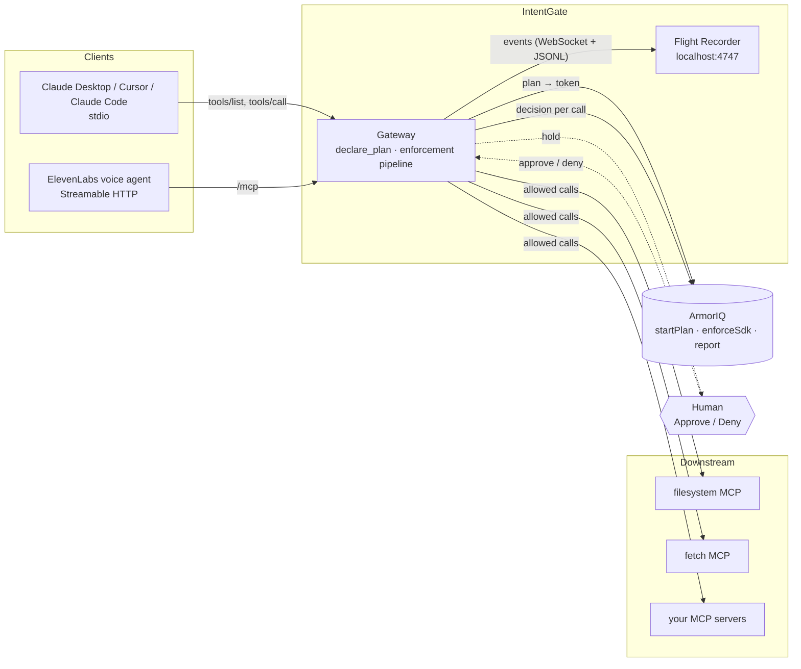
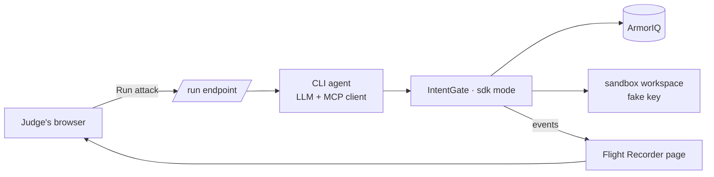

# Architecture

IntentGate is one Node process with three faces: an MCP **server** towards the client, an MCP **client** towards your real servers, and a small **web server** for the Flight Recorder. ArmorIQ sits beside it as the authority that signs plans and makes decisions.

## System diagram

## Request lifecycle

1. **Startup.** IntentGate reads `intentgate.config.json`, spawns every downstream server, lists their tools and re-exposes them as `<server>__<tool>`. It adds two tools of its own: `declare_plan` and `amend_plan`. The server `instructions` tell the model to call `declare_plan` before anything else.
2. **Plan.** The model calls `declare_plan(goal, steps)`. IntentGate maps the steps to ArmorIQ tool calls and calls `session.startPlan()`. ArmorIQ captures the plan and returns an intent token: `planId`, `planHash`, `stepProofs`, a JWT and an expiry. The receipt is shown to the model and streamed to the recorder.
3. **Call.** For every `tools/call`, the pipeline runs in order and stops at the first block:
   - no plan yet → block with a hint to call `declare_plan`
   - **ArmorIQ decision** (`enforceSdk`): tool in plan, org policy, hold rules
   - **argument binding** (IntentGate): declared arguments must match, paths normalised, globs honoured
   - **hold** → the call waits for Approve or Deny in the recorder, with an optional spoken alert
   - forward to the downstream server, report the result to ArmorIQ, emit the event
4. **Record.** Every event (plan, allow, block, hold, approval, result) is appended to a JSONL file per session and pushed over WebSocket to the recorder UI. Sessions can be replayed later with `intentgate ui`.

## Enforcement modes

| Mode | Where the decision is made | Status (Oct 10, 2026) |
|---|---|---|
| `sdk` (default) | ArmorIQ backend, `POST /iap/sdk/enforce` | works, ~650 ms per call |
| `local` | in-process, verifies the token's EdDSA JWT | fails closed: backend publishes no public key yet |
| `proxy` | ArmorIQ proxy forwards the call itself | needs the MCP registered and reachable by ArmorIQ |
| `offline` (`--offline`) | in-process, unsigned | local development and tests only, never for the demo |

See [spike-notes](./spike-notes.md) for the measurements behind this table.

## Hosted playground

The same process runs on a small always-on host (Railway or Fly) for judges:

- Each run gets its own session and workspace copy, so two judges never share state.
- `--passthrough` mode powers the "without IntentGate" half of the split screen: the engine is not constructed at all and the leak is real, against the fake key and a local collector.
- The public URL of this deployment is what gets registered as the MCP server on platform.armoriq.ai.

## Boundaries

- **Clients** never see ArmorIQ. They see one MCP server with a few extra tools and clear error messages.
- **Downstream servers** never see ArmorIQ either. They receive only calls that passed every layer.
- **Secrets** stay local: the ArmorIQ key is read from the environment, the recorder binds to localhost, and session logs live in the user's config directory.
